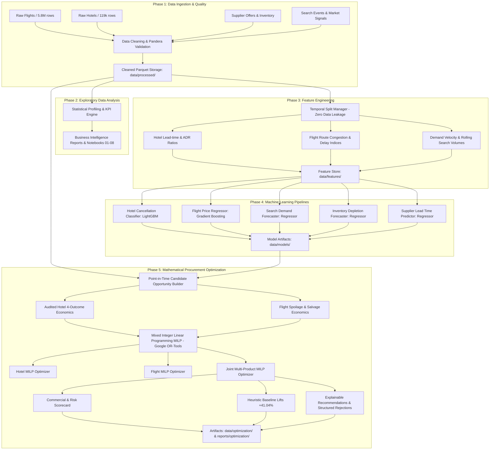

# TBO InventoryIQ — AI-Powered Travel Inventory & Profit Optimization Platform

[](https://www.python.org/downloads/)
[](tests/)
[-orange.svg)](https://developers.google.com/optimization)
[]()

> **TBO InventoryIQ** is an enterprise-grade AI decision support and mathematical profit optimization platform engineered for travel wholesalers, B2B consolidators, and Online Travel Agencies (OTAs). It bridges historical reservation datasets, real-time customer search queries, dynamic flight fare feeds, hotel inventory availability, supplier wholesale offers, and seasonal macroeconomic signals to formulate optimal inventory procurement plans that maximize expected net profit under risk, budget, capacity, and commercial constraints.

---

## 1. Project Identity & Team

- **Project:** TBO InventoryIQ – AI-Powered Travel Inventory & Profit Optimization Platform
- **Team Name:** Team Sabuj Sangha
- **Members:** Abhranil Pal & Arka Dyuti Bose
- **Repository Remote:** [github.com/abhranil1113/TravelProfitAI](https://github.com/abhranil1113/TravelProfitAI)

---

## 2. End-to-End Platform Architecture

The system is structured as a 5-phase modular pipeline ensuring point-in-time correctness, zero target leakage, robust machine learning calibration, and mathematically proven optimal procurement recommendations:



---

## 3. Phase-by-Phase Technical Breakdown

### Phase 1: Data Pipeline & Data Quality Engineering (`data_pipeline/`)
- **Ingestion Scale:** 5.8M flight operations records (tracked via Git LFS), 119k hotel bookings, 300k flight pricing quotes, 10k customer searches, 5k supplier offers, and 5k inventory snapshots.
- **Data Hygiene:** Standardized temporal types (ISO-8601), resolved airport code mismatches, filtered negative fares/rates, eliminated duplicate records, and validated referential key integrity across datasets.
- **Business Rule Enforcement:** Arrival $\ge$ reservation date, positive procurement costs, valid currency tags, and capacity conservation ($\text{available} = \text{total} - \text{booked}$).
- **Testing:** 27 automated tests passing in `tests/data_quality/`.

### Phase 2: Exploratory Data Analysis & Business Intelligence (`eda/`)
- **Statistical Profiling:** Analyzed lead-time distributions, cancellation rates across customer cohorts, route congestion, and supplier margin spreads.
- **KPI Engine:** Calculated on-time performance (OTP), revenue per available room (RevPAR), average daily rate (ADR) elasticities, and search-to-book funnels.
- **Analysis Notebooks:** 8 comprehensive Jupyter notebooks (`notebooks/01_...` through `08_...`).
- **Testing:** 41 automated tests passing in `tests/eda/`.

### Phase 3: Production Feature Engineering (`feature_engineering/`)
- **Temporal Integrity:** Implemented `SplitManager` to enforce chronological cutoff dates, preventing lookahead leakage.
- **Engineered Domains:**
  - *Hotels:* Lead time buckets (`0-7d`, `8-30d`, `31-90d`, `90d+`), stay duration, weekend/weekday nights ratio, guest composition, historical cancellation rates by distribution channel.
  - *Flights:* Advance purchase window, route popularity indices, airline historical delay likelihood, departure weekend flags.
  - *Demand:* Destination search velocity, 7-day and 30-day rolling search volume sums, holiday/festival calendar indicators.
  - *Suppliers:* Historical fulfillment reliability, lead time variance, margin spread.
- **Testing:** 33 automated tests passing in `tests/feature_engineering/`.

### Phase 4: Machine Learning & Predictive Modeling (`modeling/`)
- **Champion Models Serialized in `data/models/`:**
  1. `hotel_cancellation`: LightGBM Classifier predicting booking cancellation risk.
  2. `flight_price`: Gradient Boosted Regressor predicting consumer market clearing prices.
  3. `demand_forecasting`: Regressor forecasting destination search demand volume.
  4. `inventory_forecasting`: Regressor predicting inventory depletion velocity.
  5. `supplier_lead_time_prediction`: Regressor predicting supplier fulfillment lead time.
- **Cross-Validation:** Time-series chronological splits with baseline benchmarking (Dummy, Linear/Logistic, Tree-based).
- **Testing:** 59 automated tests passing in `tests/modeling/`.

### Phase 5: Mathematical Inventory Procurement Optimization (`optimization/`)
- **Audited Economic Formulations:**
  - *Hotel 4-Outcome Economics:* Partitions room-night outcome space into Unsold, Completed, Cancelled & Resold, and Cancelled & Unresold:
    $$e_i^H = \theta(1-p_c)p + \theta p_c(1-r_c)p + \theta p_c f \delta p + \left[(1-\theta)r_{\text{supp},u} + \theta p_c(1-f)r_{\text{supp},c}\right]c - c$$
  - *Flight Spoilage & Salvage Model:* Evaluates 0% baseline spoilage vs 10% contractual salvage, with analytical break-even calculation ($\theta^*$):
    $$e_j^F = \theta_j p_j + (1-\theta_j) s_j c_j - c_j - (1-\theta_j)\psi_j$$
  - *Prototype EUR/INR ADR Scaling:* Mitigates the 91.25-sigma currency blowout using audited prototype conversion ($90\times$) and Bayesian shrinkage against baseline priors ($\lambda = 0.70$).
- **Mathematical Optimization Engine (Google OR-Tools):**
  - High-performance Mixed Integer Linear Programming (MILP) using SCIP (primary) and CBC/HIGHS/SAT (fallbacks).
  - Supports Hotel-only (`HotelProcurementOptimizer`), Flight-only (`FlightProcurementOptimizer`), and Joint unified multi-product procurement (`JointProcurementOptimizer`).
  - Enforces shared budget limits, Minimum Order Quantities (MOQ), supplier capacities, category bounds, destination search demand ceilings, and supplier concentration risk caps (e.g., max 20% budget per supplier).
  - Physical unit segregation: **Room-nights and flight seats are never summed into common physical units**.
- **Commercial Evaluation & Baseline Comparison:**
  - **+41.04% Profit Lift** over standard commercial Greedy Gross Margin heuristics.
  - Parametric sensitivity sweeps across budget levels (₹50k to ₹1M), sell-through rates, and risk caps.
- **Explainable Recommendations & Structured Rejections:**
  - Actionable recommendations with transparent rationale explanations.
  - Clear rejection codes for unselected offers (`NEGATIVE_CONTRIBUTION`, `MOQ_EXCEEDS_DEMAND`, `SUPPLIER_CAP_BINDING`, `MOQ_EXCEEDS_BUDGET`, `NOT_SELECTED_BY_OPTIMAL_ALLOCATION`).
- **Testing:** 30 automated tests passing in `tests/optimization/`.

---

## 4. Scalability & Performance Benchmarks

All benchmarks were evaluated on the real project dataset using Google OR-Tools SCIP backend:

| Offer Pool Size | Decision Variables | Constraints | Solver Backend | Termination Status | Proven Optimal | Net Profit (INR) | Capital Spend (INR) | Solve Time |
|:---:|:---:|:---:|:---:|:---:|:---:|:---:|:---:|:---:|
| **10** | 20 | 40 | SCIP | OPTIMAL | True | ₹9,057.28 | ₹97,184.61 | **0.0048s** |
| **50** | 100 | 137 | SCIP | OPTIMAL | True | ₹13,790.24 | ₹194,114.79 | **0.0060s** |
| **100** | 200 | 238 | SCIP | OPTIMAL | True | ₹15,173.84 | ₹221,886.67 | **0.0266s** |
| **500** | 1,000 | 1,039 | SCIP | OPTIMAL | True | ₹43,756.09 | ₹488,577.74 | **0.2392s** |
| **1,000** | 2,000 | 2,039 | SCIP | OPTIMAL | True | ₹49,603.97 | ₹499,801.37 | **0.7388s** |
| **3,257 (Full Pool)** | 6,514 | 6,553 | SCIP | OPTIMAL | True | ₹57,636.92 | ₹499,727.44 | **1.9252s** |

*Result:* The solver consistently finds the mathematically proven global optimum ($0.00\%$ MIP gap) in under 2 seconds across 6,500+ variables.

---

## 5. Automated Test Suite (190 / 190 Passing)

The repository enforces complete regression protection across all project phases:

```text
====================================================== test session starts ======================================================
platform win32 -- Python 3.10.0, pytest-8.3.4, pluggy-1.7.0
rootdir: C:\Users\AbhranilPal\Programs\Projects\TBO-InventoryIQ

tests/data_quality/           [27 PASSED]  Schema validation, business rules, cleaning pipeline, ID integrity
tests/eda/                    [41 PASSED]  Profiling, relationships, KPIs, snapshot handling, currency safety
tests/feature_engineering/    [33 PASSED]  Hotel/flight/demand/supplier features, temporal split, leakage checks
tests/modeling/               [59 PASSED]  ML cross-validation, LightGBM/linear models, metrics, persistence
tests/optimization/           [30 PASSED]  4-outcome economics, break-even, MILP solvers, recommendations, pipeline

================================================ 190 passed in 238.19s (0:03:58) ================================================
```

---

## 6. Repository Directory Structure

```text
TBO-InventoryIQ/
├── data/
│   ├── raw/                           # Raw immutable datasets (flights, hotels, prices)
│   ├── synthetic/                     # Synthetic market signals, offers, searches
│   ├── processed/                     # Cleaned Parquet tables
│   ├── features/                      # Feature engineered datasets
│   ├── models/                        # Serialized ML pipelines (LightGBM, Regressors)
│   └── optimization/                  # Recommendations CSV, rejected CSV, summary JSON
│
├── data_pipeline/                     # Phase 1: Cleaning & validation framework
│   ├── cleaning/                      # Dataset cleaning modules
│   ├── validation/                    # Business rules, schema, and outlier validators
│   └── ingestion/                     # Memory-efficient parquet loader
│
├── eda/                               # Phase 2: Exploratory data analysis
│   ├── profiling.py                   # Statistical distributions
│   ├── kpi_calculations.py            # Travel commercial metrics
│   └── visualization.py               # Automated chart rendering
│
├── feature_engineering/               # Phase 3: Feature store & temporal splits
│   ├── hotel_features.py              # Cohort and cancellation features
│   ├── flight_features.py             # Route and delay features
│   ├── demand_features.py             # Search volume and holiday signals
│   └── split_manager.py               # Chronological cutoff leakage prevention
│
├── modeling/                          # Phase 4: Machine learning pipelines
│   ├── pipeline.py                    # Cross-validation orchestrator
│   ├── model_factory.py               # Model instantiation (LightGBM, Linear, Trees)
│   └── model_persistence.py           # Joblib serialization with metadata
│
├── optimization/                      # Phase 5: Optimization & Recommendation Engine
│   ├── config.py                      # Master OptimizationConfig & FinancialAssumptions
│   ├── schemas.py                     # Type-safe Pydantic contracts
│   ├── exceptions.py                  # Domain exception hierarchy
│   ├── data/                          # CandidateOpportunityBuilder & demand bounds
│   ├── predictions/                   # ML inference connectors & EUR ADR scaling
│   ├── economics/                     # Audited 4-outcome hotel & flight economics
│   ├── solvers/                       # SCIP/CBC MILP optimizers (Hotel, Flight, Joint)
│   ├── evaluation/                    # Commercial scorecard, baselines, sensitivity
│   ├── recommendations/               # Explainable rationales & rejection codes
│   └── pipeline.py                    # End-to-end master orchestrator
│
├── notebooks/                         # Interactive Jupyter Notebooks (01 to 13)
├── reports/                           # Technical audit reports (Data, EDA, ML, Optimization)
├── scripts/                           # Benchmark scripts and test runners
├── tests/                             # 190 pytest automated unit & regression tests
├── requirements.txt                   # Production package dependencies
└── pyproject.toml                     # Pytest configuration
```

---

## 7. Quick Start & Execution Guide

### 1. Installation
```bash
# Clone the repository
git clone https://github.com/abhranil1113/TravelProfitAI.git
cd TravelProfitAI

# Install dependencies
pip install -r requirements.txt
```

### 2. Execute the Optimization Pipeline
Run the full ML-powered procurement optimization engine in Python:
```python
from optimization import OptimizationConfig, OptimizationPipeline

# Configure run parameters
config = OptimizationConfig(
    run_id="PROD_OPTIMIZATION_001",
    optimization_timestamp="2026-06-01",
    total_budget=250000.0,
    target_currency="INR",
    allow_prototype_currency_override=True
)

# Run end-to-end pipeline
pipeline = OptimizationPipeline(config)
plan = pipeline.run(output_dir="data/optimization")

print(f"Status: {plan.evaluation_metrics.solver_status}")
print(f"Total Spend: INR {plan.evaluation_metrics.total_spend:,.2f}")
print(f"Expected Net Profit: INR {plan.evaluation_metrics.expected_net_profit:,.2f}")
print(f"Return on Spend: {plan.evaluation_metrics.return_on_procurement_spend:.2%}")
print(f"Recommended Offers Count: {len(plan.recommendations)}")
```

Or execute directly from the terminal:
```bash
python -c "from optimization import OptimizationConfig, OptimizationPipeline; pipeline = OptimizationPipeline(OptimizationConfig(run_id='CLI_RUN', total_budget=250000.0)); plan = pipeline.run(); print('Status:', plan.evaluation_metrics.solver_status, '| Total Spend: INR', plan.evaluation_metrics.total_spend, '| Expected Net Profit: INR', plan.evaluation_metrics.expected_net_profit)"
```

### 3. Run the Automated Test Suite
```bash
# Run all 190 automated unit & regression tests:
pytest tests/ -v

# Run Phase 5 optimization tests specifically:
pytest tests/optimization/ -v
```

### 4. Run the Scalability Benchmarks
```bash
python -c "import sys; sys.path.insert(0, '.'); from scripts.benchmark_optimization_performance import run_benchmarks; run_benchmarks()"
```

---

## 8. Master Documentation Index

| Documentation File | Location | Content Covered |
| :--- | :--- | :--- |
| **Master Documentation** | [`README.md`](file:///c:/Users/AbhranilPal/Programs/Projects/TBO-InventoryIQ/README.md) | Complete front-page documentation for Phases 1–5, architecture, and quickstart |
| **System Architecture** | [`docs/system-architecture.md`](file:///c:/Users/AbhranilPal/Programs/Projects/TBO-InventoryIQ/docs/system-architecture.md) | Architectural specifications, data flow, and pipeline components |
| **Project Overview** | [`docs/project-overview.md`](file:///c:/Users/AbhranilPal/Programs/Projects/TBO-InventoryIQ/docs/project-overview.md) | Business problem statement, stakeholder requirements, and platform goals |
| **ML Documentation** | [`docs/ml-model-documentation.md`](file:///c:/Users/AbhranilPal/Programs/Projects/TBO-InventoryIQ/docs/ml-model-documentation.md) | Model architectures, features, cross-validation metrics, and serialization |
| **Optimization Methodology** | [`docs/optimization-methodology.md`](file:///c:/Users/AbhranilPal/Programs/Projects/TBO-InventoryIQ/docs/optimization-methodology.md) | Mathematical economics, MILP formulation, OR-Tools solver design, and risk caps |
| **Phase 5 Final Report** | [`reports/optimization/phase5_final_completion_report.md`](file:///c:/Users/AbhranilPal/Programs/Projects/TBO-InventoryIQ/reports/optimization/phase5_final_completion_report.md) | Formal engineering completion report for Phase 5 |
| **Assumptions Register** | [`reports/optimization/optimization_assumptions.md`](file:///c:/Users/AbhranilPal/Programs/Projects/TBO-InventoryIQ/reports/optimization/optimization_assumptions.md) | Audited commercial assumptions, currency rules, and refund parameters |
