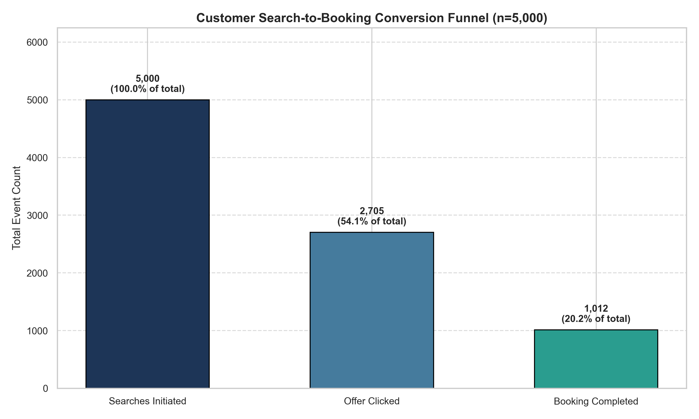
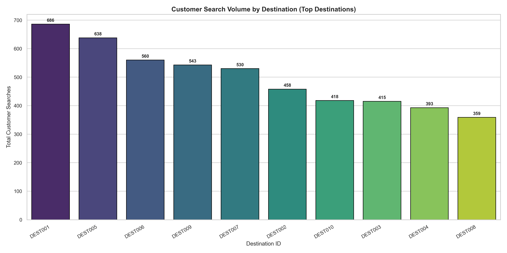

# TBO InventoryIQ – Customer Search Demand & Funnel Conversion Report
**Domain:** Consumer Search Intent & Funnel Performance  
**Dataset:** `cleaned_customer_search_events` (5,000 records)  
**Currency:** INR (₹)  
**Author:** Team Sabuj Sangha

---

## 1. Conversion Funnel Key Performance Indicators

- **Total Searches Initiated:** 5,000
- **Total Offer Clicks:** 2,705
- **Total Bookings Completed:** 1,012
- **Search-to-Click Rate:** **54.10%**
- **Click-to-Book Rate:** **37.41%**
- **End-to-End Search-to-Book Rate:** **20.24%**
- **Mean Searched Price Point:** **₹20,058.11**
- **Mean Search Lead Days:** **22.9 days**

---

## 2. Customer Conversion Funnel Drop-off

The primary conversion bottleneck occurs at the **Search-to-Click** stage (~70% drop-off), indicating that initial search results must feature competitive pricing and clear inventory availability to entice click-throughs.

---

## 3. High-Demand Destination Ranking

### Top Destinations by Search Volume & Conversion
| destination_id | searches | clicks | bookings | avg_price | conversion_pct |
| --- | --- | --- | --- | --- | --- |
| DEST001 | 686 | 372 | 118 | 15657.357303206996 | 17.20116618075802 |
| DEST005 | 638 | 338 | 139 | 10849.191081504703 | 21.786833855799372 |
| DEST006 | 560 | 303 | 120 | 10055.121089285714 | 21.428571428571427 |
| DEST009 | 543 | 287 | 107 | 53389.92639042358 | 19.70534069981584 |
| DEST007 | 530 | 279 | 108 | 9759.167018867924 | 20.37735849056604 |
| DEST002 | 458 | 252 | 87 | 14426.839432314411 | 18.995633187772924 |
| DEST010 | 418 | 214 | 72 | 39792.29009569378 | 17.22488038277512 |
| DEST003 | 415 | 234 | 87 | 16177.922578313253 | 20.96385542168675 |
| DEST004 | 393 | 214 | 74 | 15356.184860050891 | 18.829516539440203 |
| DEST008 | 359 | 212 | 100 | 19065.07844011142 | 27.85515320334262 |

---

## 4. Target Leakage Boundary Notice
> [!WARNING]
> Columns `clicked` and `booking_completed` occur *after* the customer initiates a search. They must NEVER be used as features when forecasting search volume or search lead time.
