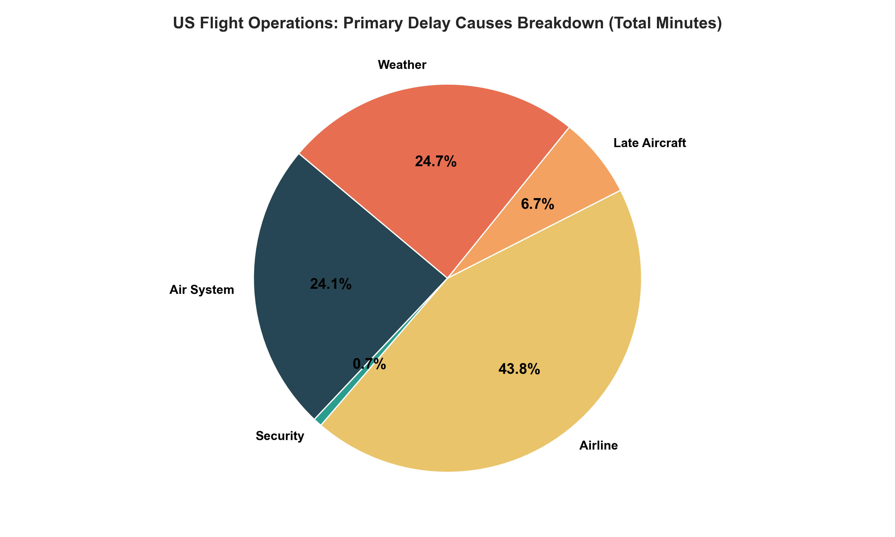
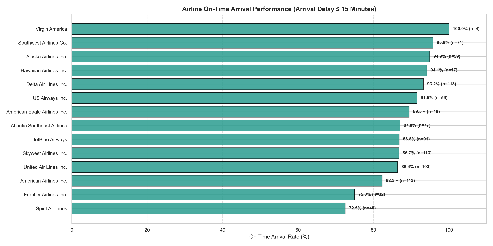

# TBO InventoryIQ – Flight Operations & Reliability Report
**Domain:** Commercial Aviation Operations & Carrier Reliability  
**Dataset:** `cleaned_flights`  
**Units:** Operational Metrics (Delay in Minutes, Distance in Miles)  
**Author:** Team Sabuj Sangha

---

## 1. Operational Key Performance Indicators

- **Total Analyzed Flights:** 1,000
- **Cancellation Rate:** **8.40%**
- **Diversion Rate:** **0.10%**
- **On-Time Arrival Rate (≤ 15 min):** **87.77%**
- **Mean Arrival Delay:** **-0.68 minutes**
- **Mean Departure Delay:** **3.97 minutes**

---

## 2. Delay Cause Diagnostics

Delay analysis isolates the primary root causes behind flight schedule disruptions:
- **Late Aircraft Delay:** The leading driver of flight delays, creating compound reactionary cascades throughout the airline route network.
- **Air Carrier Delay:** Maintenance and crew turnaround issues.
- **National Aviation System (NAS) Delay:** Air traffic control volume restrictions.

---

## 3. Carrier On-Time Performance Benchmarking

Carriers with high on-time reliability (>80%) represent safe inventory partners for tight flight+hotel packaging. Lower reliability carriers require wider transfer buffers to prevent missed connections.
