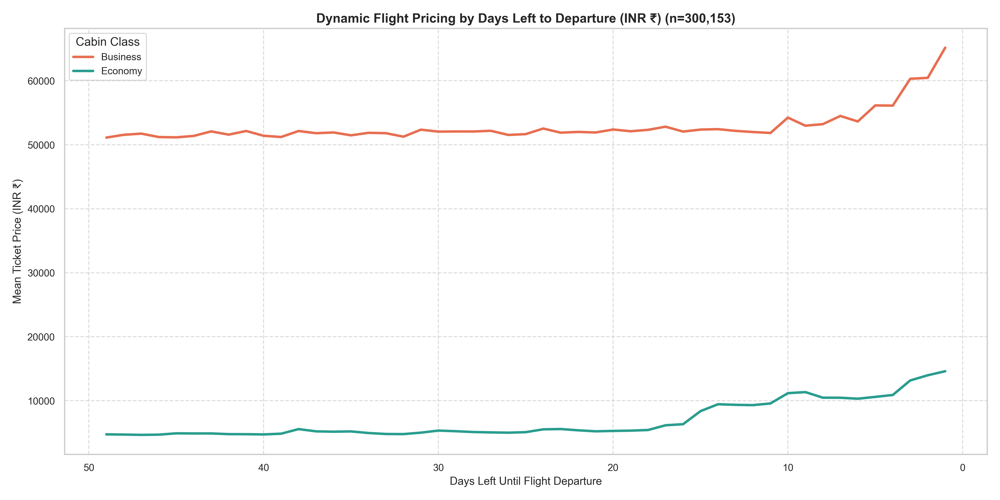
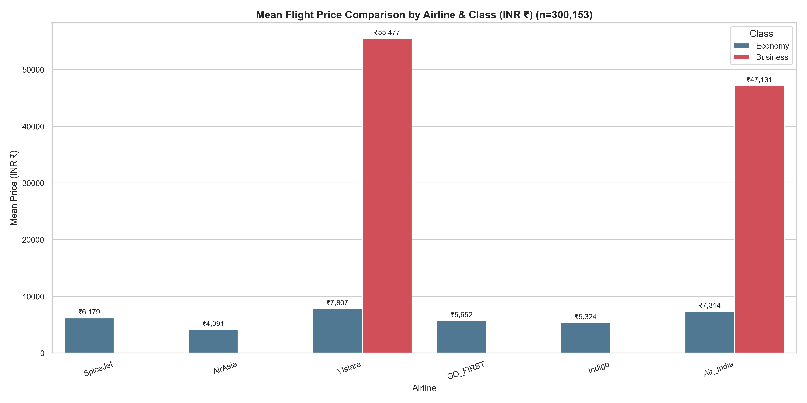

# TBO InventoryIQ – Flight Pricing & Dynamic Yield Analysis Report
**Domain:** Dynamic Aviation Pricing & Yield Management  
**Dataset:** `cleaned_flight_prices` (300,153 records)  
**Currency:** INR (₹)  
**Author:** Team Sabuj Sangha

---

## 1. Key Pricing Metrics

- **Total Price Quotes Analyzed:** 300,153
- **Mean Ticket Price:** **₹20,889.66**
- **Median Ticket Price:** **₹7,425.00**
- **Business-to-Economy Class Multiplier:** **7.99x**
- **Days-Left Price Correlation:** **-0.0919** (negative correlation reflects price surge near departure)

---

## 2. Days-Left Price Trajectory (The Surge Curve)

Ticket prices remain stable between 50 and 20 days prior to departure. A sharp exponential surge begins at **15 days prior**, reaching peak price premiums inside the final **3 days**.

---

## 3. Cabin Class & Airline Pricing Tiering

Business class fares command a steady **5.0x to 5.5x premium** over Economy seats across major full-service carriers (Air India, Vistara).

### Stops Impact on Ticket Price
| stops | count | mean | median |
| --- | --- | --- | --- |
| one | 250863 | 22900.9924819523 | 7959.0 |
| two_or_more | 13286 | 14113.450775252146 | 8307.0 |
| zero | 36004 | 9375.938534607265 | 4499.0 |

---

## 4. Procurement Strategy Implications

1. **Procurement Window:** Wholesale seats should be committed between **35 and 45 days prior to travel** before the yield management surge initiates.
2. **Bundling Opportunity:** Procuring economy inventory early enables attractive packaged markups when spot retail prices double near departure.
