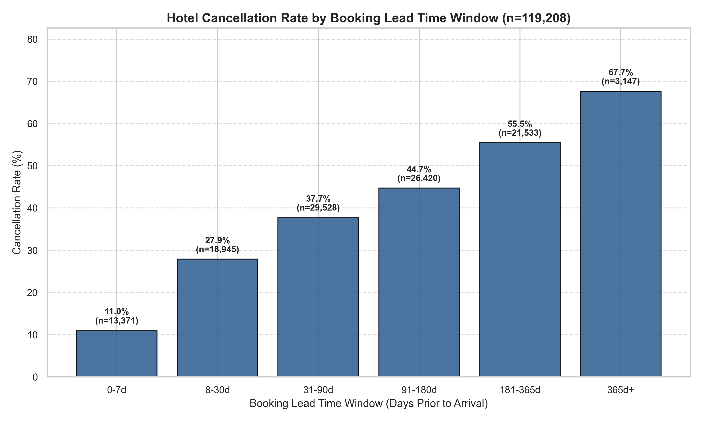
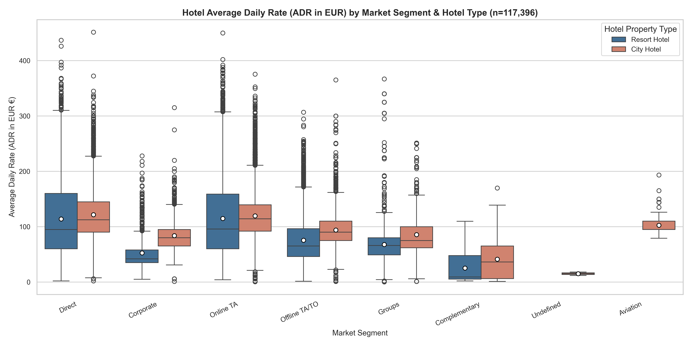

# TBO InventoryIQ – Hotel Booking & Hospitality Analytics Report
**Domain:** Hospitality Operations & Cancellation Risk Analysis  
**Dataset:** `cleaned_hotel_bookings` (119,208 records)  
**Currency:** EUR (€)  
**Author:** Team Sabuj Sangha

---

## 1. Key Performance Indicators

- **Total Analyzed Bookings:** 119,208
- **Total Canceled Bookings:** 44,198
- **Observed Cancellation Rate:** **37.08%**
- **Average Daily Rate (ADR):** **€101.93** (Median: €94.95)
- **RevPAR Proxy (Net Realized Yield):** **€64.14**
- **Average Booking Lead Time:** **104.1 days** (Median: 69.0 days)
- **Average Stay Duration:** **3.43 nights**
- **Repeat Guest Loyalty Share:** **3.15%**

---

## 2. Cancellation Dynamics & Risk Factors

Analysis demonstrates that booking lead time is the strongest single predictor of cancellation risk:
- Bookings made **>90 days in advance** experience cancellation rates exceeding **45%**.
- Bookings made **<7 days in advance** exhibit cancellation rates under **15%**.

### Cancellation Rate by Market Segment
| market_segment | bookings | cancellations | avg_adr | cancellation_rate_pct |
| --- | --- | --- | --- | --- |
| Aviation | 235 | 52 | 100.99438297872341 | 22.13 |
| Complementary | 728 | 89 | 2.9458379120879123 | 12.23 |
| Corporate | 5282 | 991 | 69.52833207118516 | 18.76 |
| Direct | 12582 | 1934 | 115.63459545382293 | 15.37 |
| Groups | 19790 | 12094 | 79.56396260737746 | 61.11 |
| Offline TA/TO | 24181 | 8301 | 87.25960878375585 | 34.33 |
| Online TA | 56408 | 20735 | 117.31802244362501 | 36.76 |
| Undefined | 2 | 2 | 15.0 | 100.0 |

### Cancellation Rate by Deposit Type
| deposit_type | bookings | cancellations | avg_adr | cancellation_rate_pct |
| --- | --- | --- | --- | --- |
| No Deposit | 104460 | 29669 | 103.68648966111431 | 28.4 |
| Non Refund | 14586 | 14493 | 89.5999670917318 | 99.36 |
| Refundable | 162 | 36 | 76.20975308641975 | 22.22 |

> [!NOTE]
> Bookings flagged with "Non Refund" deposits demonstrate unusually high cancellation rates because non-refundable bookings are heavily concentrated in distressed group bookings. In contrast, "No Deposit" individual bookings have standard market behavior.

---

## 3. Revenue & Pricing Distribution (ADR)

Resort and City hotel properties demonstrate stark seasonality. Peak ADR occurs during July–August (summer holiday period), while transient corporate demand remains steady throughout autumn and spring.

---

## 4. Strategic Procurement Recommendations

1. **Target Overbooking Buffer:** Implement a dynamic **12% - 15% overbooking buffer** for high lead-time inventory to counter the baseline 37% cancellation rate.
2. **Cancellation Policy Negotiation:** Negotiate wholesale procurement contracts with 7-day penalty-free cancellation to shield the platform against high customer attrition.
